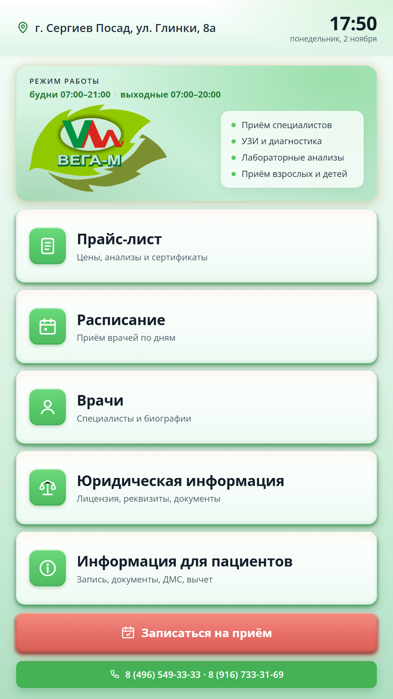

# Инфо-киоск «Вега-М»

Сенсорная справочная панель для холла клиники · Node.js + Microsoft SQL Server



## 1. Название

«Инфо-киоск „Вега-М“» — сенсорная информационная панель, которая сама отвечает посетителю клиники на типовые вопросы: цены, расписание, врачи, документы и запись на приём.

## 2. Проблема

Каждый день регистратура отвечает на одни и те же вопросы: сколько стоит услуга, когда принимает врач, к кому обратиться, как записаться и какие документы взять. Это отвлекает администраторов от записи и сложных обращений, создаёт очередь и звонки.

- бумажные прайсы и расписания быстро устаревают, их приходится перепечатывать;
- информация недоступна, когда регистратура занята или закрыта;
- данные в МИС меняются, а стенды в холле остаются прежними;
- посетителю неудобно искать сведения в нескольких местах и спрашивать персонал.

**Суть задачи.** Нужна одна точка самообслуживания, которая показывает актуальные данные из МИС и не требует ручного ведения контента.

## 3. Пользователь

- **Основной:** посетитель клиники — пациент или сопровождающий, который пришёл без подготовки и не хочет стоять в очереди к регистратуре.
- **Вторичный:** администраторы и регистратура — меньше повторяющихся вопросов и звонков.
- **Управление:** руководство клиники — единый фирменный стиль и актуальная информация во всех разделах.
- **Технический:** ИТ-специалист и администратор — установка, автозапуск, обновления и диагностика без ежедневного участия.

## 4. Основная функция

**Вход.** Данные из МИС Archimed+ через четыре вьюхи только для чтения — прайс (около 5 100 услуг в четырёх каталогах: прейскурант «Вега-М», лаборатория ИНВИТРО, лаборатория Ситилаб, сертификаты), расписание смен с сегодняшнего дня, справочник врачей со специальностями и биографиями, фотографии. Плюс статические материалы: информация для пациентов, лицензия, реквизиты, политика конфиденциальности, подарочные сертификаты.

**Обработка.** Сервер на Node.js кэширует данные (прайс — 10 минут, расписание — 2 минуты, врачи — 30 минут), сохраняет снимки на диск и отдаёт клиенту JSON API. Клиент рисует интерфейс как макет 1080×1920 и масштабирует его под экран. Если база недоступна, киоск показывает последний снимок и предупреждение.

**Выход.** То, что видит посетитель на сенсорном экране:

- главный экран с плитками «Прайс», «Расписание», «Врачи» и дополнительными разделами;
- поиск по прайсу с экранной клавиатурой (русская и английская раскладки);
- расписание по дням, внутри дня — по специальностям, смены по времени начала;
- карточки врачей с фото, специальностями и биографией; главный врач выделен отдельным блоком и плашкой;
- запись на приём через штатный виджет Archimed — талон создаётся по правилам клиники, без ручной записи в базу;
- юридические документы, информация для пациентов и подарочные сертификаты.

## 5. Формат результата

- готовый сенсорный экран в холле клиники, а не документ или отчёт;
- посетитель получает ответ за два-три касания, без участия регистратуры;
- данные обновляются из МИС автоматически — прайс, смены и карточки врачей не нужно вести вручную;
- при недоступности базы киоск продолжает работать на последнем снимке и после восстановления обновляется сам;
- оформление совпадает с сайтом клиники: зелёная палитра, Open Sans, логотип;
- для клиники — предсказуемая работа без ежедневного сопровождения: сервер и браузер запускаются автоматически и перезапускаются после сбоя.

## 6. Минимальный функционал

**Первая версия (развёрнута и работает):**

- три основных раздела — «Прайс», «Расписание», «Врачи» — плюс информация для пациентов, юридические документы и сертификаты;
- прайс с поиском и экранной клавиатурой;
- расписание с сегодняшнего дня с фильтром публикации;
- карточки врачей с фото, специальностями, биографиями и плашкой «Главный врач»;
- запись на приём через виджет Archimed с автосбросом после 90 секунд бездействия;
- офлайн-снимки и жёлтая плашка при недоступности базы;
- автозапуск сервера и браузера, перезапуск после падения, правило брандмауэра;
- отдельный SQL-логин только на четыре вьюхи — пароль не попадает на киоск;
- самоперезагрузка при обновлении версии, кроме момента записи или чтения документа;
- масштабирование под обычный монитор — удобно проверять и показывать.

**Планы развития:**

- электронная очередь с талоном и ожидаемым временем;
- проверка, отмена и перенос своей записи по номеру телефона;
- оплата услуг и сертификатов картой;
- доступность: английская версия, крупный шрифт, высокий контраст, голосовые подсказки;
- аналитика востребованности разделов без сбора персональных данных;
- административная панель для текстов, новостей и объявлений;
- единый сервер на несколько киосков и филиалов;
- проверка полиса ДМС на киоске;
- автотесты интерфейса и API, мониторинг доступности.

## 7. Технологии

| Слой | Технологии | Роль в проекте |
|---|---|---|
| Сервер | Node.js 24, Express 4, mssql 11, compression | API, кэш, раздача статики |
| Клиент | HTML5, CSS3, JavaScript без фреймворка | интерфейс 1080×1920, поиск, анимации |
| Данные | Microsoft SQL Server, четыре вьюхи `v_kiosk_*` | только чтение, без доступа к ПДн |
| Обмен | REST / JSON, HTTP-порт 8080 | данные и статический клиент |
| Офлайн | JSON-снимки в папке `data/` | работа при недоступной базе |
| Оформление | Open Sans (локально, woff2), PNG и PDF | фирменный стиль без интернета |
| Автозапуск | PowerShell 5.1, Планировщик Windows (S4U), Edge `--kiosk` | старт и восстановление без входа |
| Безопасность | отдельный SQL-логин, конфиг с урезанным ACL | пароль остаётся на сервере |

## 8. Состав репозитория

| Путь | Назначение |
|---|---|
| `server.js` | Node-сервер: API, кэш, снимки, раздача статики |
| `public/` | клиент: `index.html`, `app.js`, `style.css`, шрифты и ассеты |
| `run_server.ps1` | супервизор: держит `node server.js` и перезапускает после падения |
| `install_task.ps1` | регистрация задачи планировщика «Vega Kiosk Server» |
| `install_browser.ps1` | настройка Edge в киоск-режиме и политик |
| `docs/` | описание проекта, скриншоты, эксплуатационная памятка |

## 9. Запуск

```powershell
npm install
node server.js
```

- порт — 8080 (`VEGA_KIOSK_PORT`);
- конфиг БД хранится **вне репозитория**: `~/.claude/tools/db/kiosk_config.json` или путь в `VEGA_KIOSK_CONFIG`;
- формат конфига:

```json
{
  "server": "host,1433",
  "database": "Archimed",
  "user": "vega_kiosk",
  "password": "<пароль>"
}
```

- в проде сервер запускается задачей планировщика «Vega Kiosk Server» (`install_task.ps1`), браузер — Edge в режиме `--kiosk` (`install_browser.ps1`);
- проверка состояния — `GET /api/health` (источник данных: `db`, `stale` или `snapshot`).

## 10. Безопасность

- отдельный SQL-логин `vega_kiosk` с правами только на четыре вьюхи `v_kiosk_*`;
- доступ к таблицам с персональными данными (`risk_list`, `polises`) у киоска отсутствует;
- пароль БД остаётся на сервере и не передаётся на сенсорный ПК;
- в репозитории нет конфигов подключения, снимков данных и журналов.
